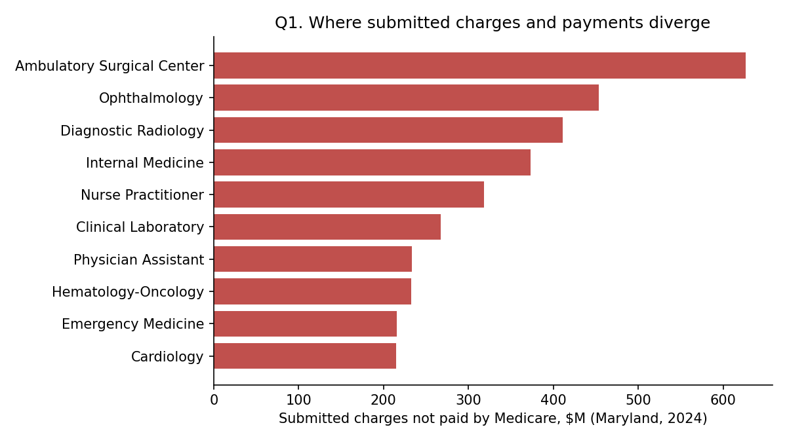

# Healthcare Payments Analysis

How do Medicare dollars move from charges to payments? A SQL and Python analysis of real, public Medicare payment data and the federal exclusion list.



## Business question
Billed charges, allowed amounts and actual payments differ. Where are the gaps, which providers look unusual against their peers, and does the data reconcile end to end?

## Data (all real, all public)
| Source | Use |
|---|---|
| CMS Medicare Physician & Other Practitioners, by Provider and Service (2024), Maryland | Charge vs payment, outliers, volume |
| CMS Medicare Physician & Other Practitioners, by Provider (2024), Maryland | Provider totals, reconciliation |
| CMS Medicare Inpatient Hospitals, by Provider (FY2024), national | Hospital charge vs payment |
| HHS-OIG List of Excluded Individuals/Entities | Exclusion matching by NPI |

No synthetic data. Raw files are not committed; `src/download.py` fetches them.

## Headline numbers
- $7.91B submitted vs $2.14B paid (27%) on 174,983 Maryland provider-service rows.
- Service detail covers 63% of provider-summary payments, so any bottom-up analysis undercounts.
- 3 Maryland providers share an NPI with an exclusion record (exclusion dated after the 2024 service year; needs review, not wrongdoing).
- Medicare paid 17% of covered charges nationally for inpatient hospitals.

Full write-up: [docs/findings.md](docs/findings.md)

## Questions
1. Q1 paid vs submitted by specialty
2. Q2 codes with the largest gap
3. Q3 provider outliers vs specialty peers
4. Q4 reconciliation of summary vs detail
5. Q5 very high daily volume
6. Q6 exclusion-list matches
7. Q7 hospital charge-to-payment ratio

Each question is one file in `sql/`. Aggregate results land in `data/processed/` (provider-level NPI lists are generated locally and not published) and charts in `dashboard/img/`.

## Run it
```
pip install pandas duckdb matplotlib
python src/download.py
python src/analyze.py
```

## Limitations
One state and one year for physician data. Aggregated data, so no duplicate-claim or date-of-death checks. Flags are screening leads and not accusations.

Built by Mahesh M.
